<p align="center">
  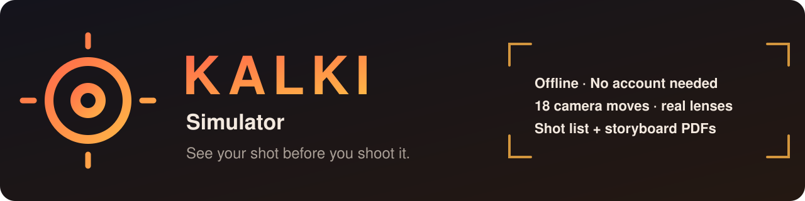
</p>

<p align="center">
  
  
  
  
</p>

<p align="center">
  <a href="#quick-start">Quick start</a> ·
  <a href="#features">Features</a> ·
  <a href="#exports">Exports</a> ·
  <a href="#roadmap">Roadmap</a> ·
  <a href="#building-from-source">Build</a> ·
  <a href="#feedback">Feedback</a>
</p>


**Kalki Simulator** is an offline camera-movement simulator for Indian filmmakers, YouTubers and film students. Block out camera moves on a 3D set, tune the lens and lighting, and hand your crew a printable shot list and storyboard. It runs from a single HTML file or a small Windows app: no account, no internet, no tracking.

<p align="center">
  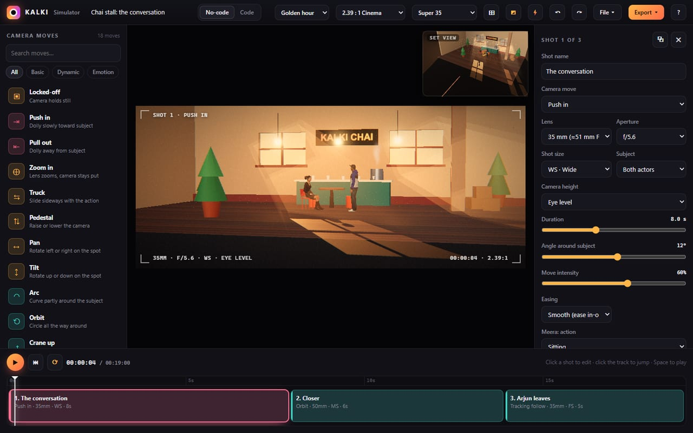
</p>

> **Private repository.** This repository holds the source code and is not public. Downloads for users are published separately.

## Quick start

**In the browser** (nothing to install)

1. Download [`Kalki-versions/Kalki-v0.6.0.html`](Kalki-versions/Kalki-v0.6.0.html), or the zipped package [`Kalki-v0.6.0.zip`](Kalki-versions/Kalki-v0.6.0.zip) with notices.
2. Double-click it. It opens in Chrome or Edge and runs fully offline.

**On Windows** (native app, about 3 MB)

1. Download [`Kalki-versions/desktop/Kalki-Simulator_0.6.0_x64-setup.exe`](Kalki-versions/desktop/Kalki-Simulator_0.6.0_x64-setup.exe) and run it. It installs for the current user, with no administrator rights.
2. The installer is **not code-signed yet**, so Windows SmartScreen may warn on first run: choose **More info, Run anyway**.
3. Exports open a native **Save as** dialog. It uses the WebView2 runtime that ships with Windows 11 (Windows 10 may prompt to install it).

<p align="center">
  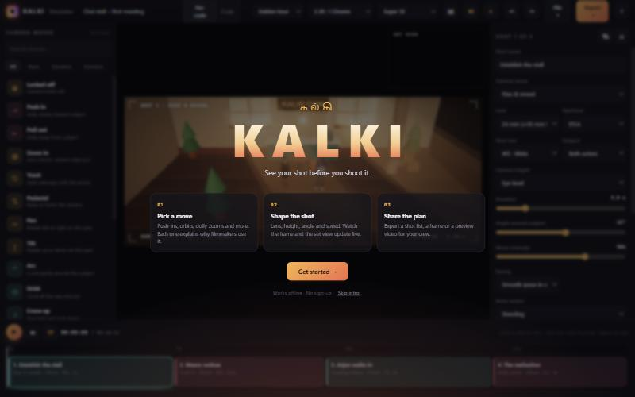
</p>

## How it works

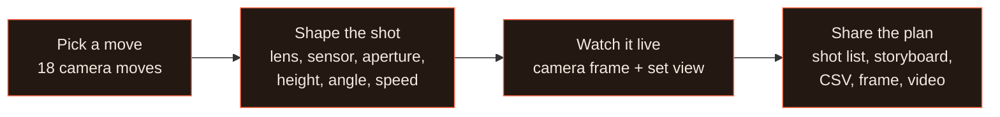

## Features

| | |
|---|---|
| **18 camera moves** | Push in, pull out, orbit, dolly zoom, crane, tracking follow and more, on a timeline. Each move explains why filmmakers use it. |
| **Real lens behaviour** | Focal length 14 to 135 mm, aperture f/1.4 to f/11 driving depth of field, plus bloom, motion blur and film grain. |
| **Camera sensors** | Super 35, Full frame, APS-C, Micro Four Thirds, 1-inch. Lenses show their full-frame equivalent. |
| **Cinematic looks** | Golden hour, Teal and orange, Night, Noir, Neutral, plus time-of-day looks (dawn, noon, dusk), with window light and sun shafts. |
| **Tamil, Hindi and English** | Switch the whole interface between English, தமிழ் and हिन्दी with the language menu. Titles, shot names and notes in any script also come out correctly in the PDFs. |
| **Choose your actors** | Seven Microsoft Rocketbox avatars (three women, four men, including an older man) play the two roles. Pick them in the cast dialog; names, eye heights and animations follow your choice, and the cast is saved in the project. |
| **Actions for each actor** | Choose what Meera and Arjun do in every shot: stand, walk, sit on a plastic chair, talk, listen, nod, sip chai, wave, look around, shrug, or invite the other to sit. See the [contact sheet](docs/samples/actions-contact-sheet.pdf). |
| **Reference video analysis** | Import a clip: Kalki finds its shots, names the camera move in each (pan, tilt, truck, push, pull, zoom, handheld or locked off), shows the pacing, suggests changes to your scene with the reason for each, and plays the result as a simulation. It runs on your computer and the video is never uploaded. |
| **Action lane** | Sequence actions inside one shot: Meera sits, then talks at 2.5 s, then sips chai at 5.5 s, while Arjun listens and nods. Parts blend smoothly and you retime them with a slider. |
| **Place the actors** | Click or drag on the set view to put Meera and Arjun anywhere on the floor, and set which way they face. The camera follows them. |
| **Any frame** | Cinema 2.39:1, YouTube 16:9, Reels and Shorts 9:16, square. |
| **Frame guides** | Press **G** to cycle rule of thirds, action and title safe areas with a centre mark, and (on 9:16) approximate Reels and Shorts interface zones. |
| **Shot notes** | A notes field on every shot for intent, blocking and references. |
| **No-code and Code modes** | Edit visually, or edit the whole scene as structured JSON. |
| **Safe by design** | Versioned `.kalki.json` projects that keep opening, undo and redo, and automatic Light mode on slow CPUs. |

### Cinematic looks

The same shot under four looks:

| Golden hour | Teal and orange |
|:-:|:-:|
|  |  |
| **Night** | **Noir** |
|  |  |

### Tamil, Hindi and English

The language menu in the top bar switches every label, tooltip, message and explanation between English, தமிழ் and हिन्दी, and remembers your choice. The translations were written without a native-speaker review, so corrections are welcome.

| தமிழ் | हिन्दी |
|:-:|:-:|
|  |  |

### Time of day

Dawn, noon and dusk join the other lighting looks.

| Dawn | Noon | Dusk |
|:-:|:-:|:-:|
|  | 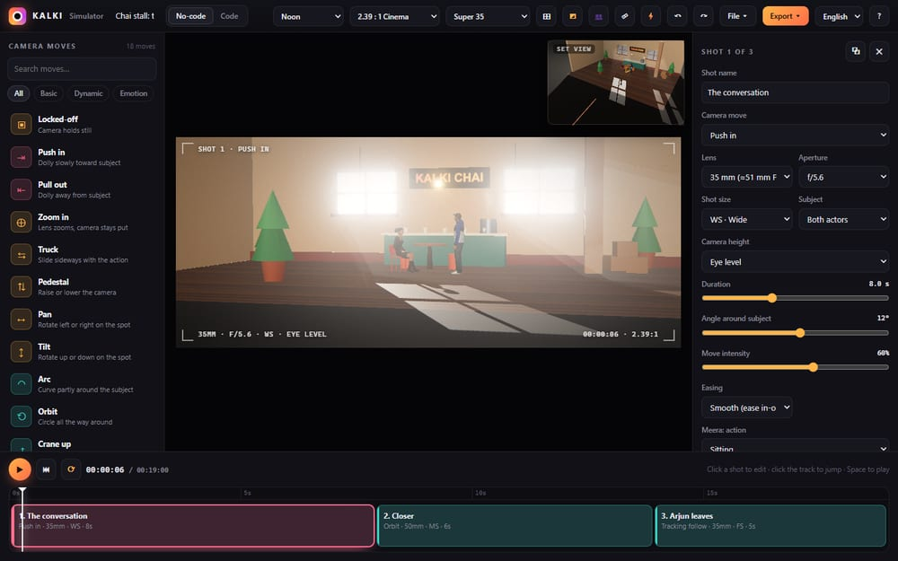 | 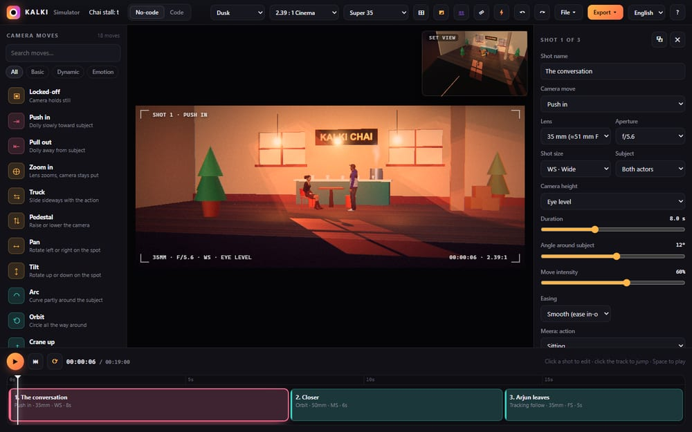 |

### Choose your actors

Press the people button to open the cast dialog and pick who plays each role. Every avatar uses the same twelve actions, placement and camera work.

<p align="center">
  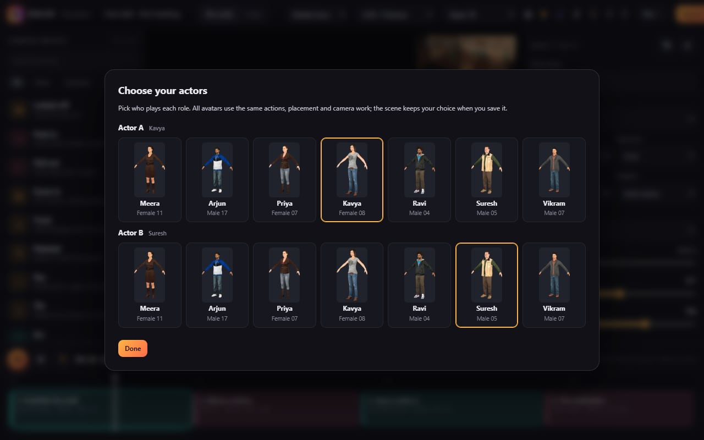
</p>

### Learn from a reference video

Press the film-strip button, choose a clip, and Kalki reports how its camera work is built. It finds each shot, names the move, shows how long each lasts and how confident it is, explains the technique, and compares the clip with your scene. Each suggestion names its rule and its reason, and you can apply one or all, then play the result. Ctrl+Z restores your scene.

<p align="center">
  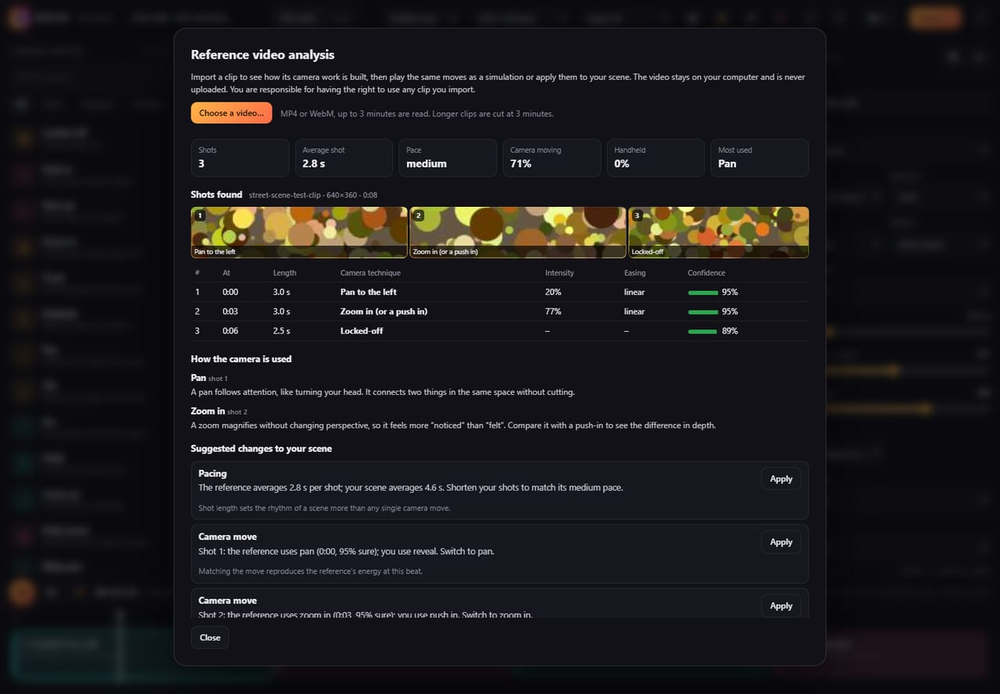
</p>

How it works: cuts are found where no camera motion can explain the change between two frames; camera motion is estimated per shot by following small blocks of the picture and fitting a shift, zoom and roll; depth cues separate a pan from a truck. There is no machine-learning model, so shot size and subject framing are not analysed yet. To try it, import the 8-second test clip [`street-scene-test-clip.webm`](docs/samples/street-scene-test-clip.webm): a pan, a cut, a zoom in, a cut and a locked-off hold. Results are estimates (a push-in and a zoom can look alike), and the report says so.

### Sequence actions inside a shot

Give each actor a sequence in the action lane: here Meera sits, then talks at 2.5 s, then sips chai at 5.5 s, while Arjun listens and nods. Parts blend smoothly, and you retime or remove them from the inspector.

<p align="center">
  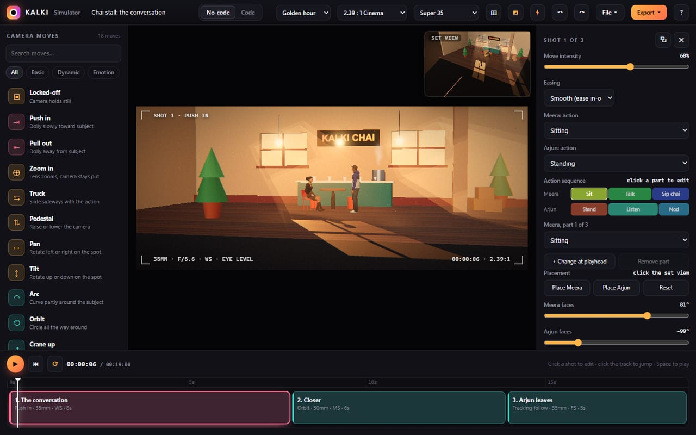
</p>

### Code mode

Everything in a scene is plain data, so setups are precise and repeatable.

<p align="center">
  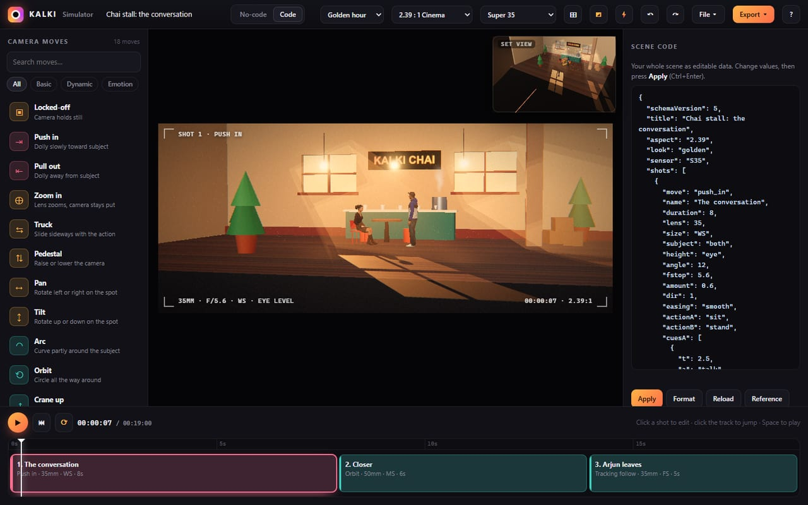
</p>

## Exports

| Export | What you get | Sample |
|---|---|---|
| **Shot list (PDF)** | A landscape A4 sheet: a frame for every shot, with move and intent, timing, lens and full-frame equivalent, aperture, shot size, height, angle, subject and your notes | [`shot-list-sample.pdf`](docs/samples/shot-list-sample.pdf) |
| **Storyboard sheet (PDF)** | A grid of frames with number, name, move, lens, size, duration and your note. The grid adapts to the aspect ratio | [`storyboard-sample.pdf`](docs/samples/storyboard-sample.pdf) |
| **Blocking diagram (PDF)** | A top-down map for every shot: where each actor stands and moves, where the camera starts, its view cone and its path | [`blocking-diagram-sample.pdf`](docs/samples/blocking-diagram-sample.pdf) |
| **Spreadsheet (CSV)** | The same data for Excel or Sheets | |
| **Frame (PNG)** | The current frame without overlays | [`frame-export-sample.png`](docs/images/frame-export-sample.png) |
| **Preview video (WebM)** | The whole sequence, recorded in one pass | |
| **Project (`.kalki.json`)** | Save and reopen your scene | |

<p align="center">
  <br>
  <sub>A frame exported with Export → Frame snapshot</sub>
</p>

## Version history

| Version | Highlights |
|---------|------------|
| v0.1 | First prototype: 18 camera moves, timeline, no-code and code modes, onboarding, exports |
| v0.2 | Cinematic look: window light and sun shafts, depth of field, bloom, motion blur, grain, 5 looks |
| v0.3 | Realistic animated actors (some browsers failed to load textures) |
| v0.3.1 | Actor textures fixed for all browsers, brighter wide shots |
| v0.4 | Shot-list PDF, sensor presets with full-frame equivalents, versioned project files |
| v0.4.1 | Storyboard sheet PDF, per-shot notes, Windows desktop app |
| v0.4.2 | Frame guides (thirds, safe areas, Reels zones), built-in self-test, PDF text fix |
| v0.5 | Actions for each actor (sit, talk, listen, nod, sip chai, wave, look, shrug, invite), chair and glass props |
| v0.5.1 | Click-to-place actors, facing control, top-down blocking diagram PDF |
| v0.5.2 | Action lane: timed action changes inside a shot, with blending |
| v0.5.3 | Reference video analysis with suggestions and simulation; Pan direction fix |
| v0.5.4 | Actor picker with seven avatars |
| **v0.6.0** | **Latest.** Tamil and Hindi interface, Tamil/Hindi text in PDFs, dawn / noon / dusk looks |

Every build is kept in [`Kalki-versions/`](Kalki-versions/). See [`VERSIONS.txt`](Kalki-versions/VERSIONS.txt).

## Roadmap

Kalki is built in small, shippable steps. Full detail, effort estimates and rationale are in [`docs/ROADMAP.md`](docs/ROADMAP.md).

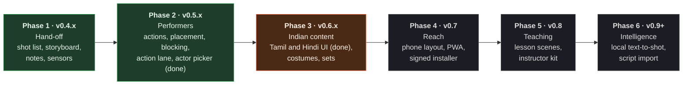

<sub>Green: shipped. Orange: next. Grey: planned. The Windows installer from Phase 4 has a first version already; code signing and offline WebView2 bundling are still open.</sub>

## Market and benchmark

- [`docs/MARKET_ANALYSIS.md`](docs/MARKET_ANALYSIS.md): target users in India, trends, pain points, pricing and positioning.
- [`docs/BENCHMARK.md`](docs/BENCHMARK.md): feature comparison with other previs, shot-list and storyboard tools.

In short: professional previs tools are priced in USD and out of reach for most Indian creators and students, and the realistic alternative is no previs at all. Kalki aims to be offline, Indic-language and quick to learn.

## Building from source

Requires Node.js. The desktop app additionally needs the [Rust toolchain](https://rustup.rs) and the Microsoft C++ Build Tools.

```bash
npm install
node build.mjs            # -> dist/Kalki.html (obfuscated)
DEBUG=1 node build.mjs    # unobfuscated build for debugging
npm test                  # PDF and analysis tests, in-browser self-test, real-video end-to-end test (needs Edge or Chrome)
npm run desktop:dev       # run the desktop app in development
npm run desktop:build     # build the Windows installer (src-tauri/target/release/bundle/nsis)
```

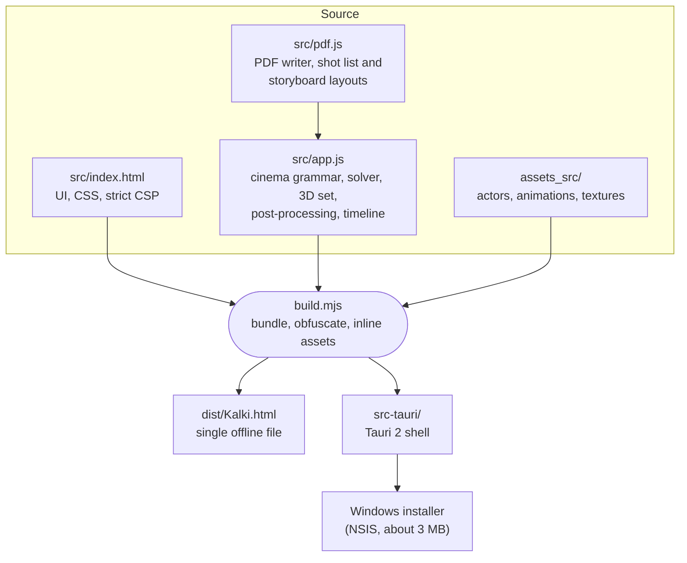

`optimize.mjs` and `texfix.mjs` rebuild the actor assets; they need the original FBX/TGA files, which are not included. Design notes are in [`DEVELOPMENT.md`](DEVELOPMENT.md).

## Feedback

Kalki Simulator is a closed-source project and does not accept code contributions. Feedback from filmmakers, film teachers and translators is very welcome: tell the author what would make it more useful on your shoots.

## Privacy

Kalki never connects to the internet and collects no data. Files are saved only where you choose to save them.

## Credits and licences

- [three.js](https://threejs.org), MIT
- [Microsoft Rocketbox](https://github.com/microsoft/Microsoft-Rocketbox) avatars and animations (Female_Adult_11, Male_Adult_17), MIT

Full notices: [`THIRD-PARTY-NOTICES.txt`](THIRD-PARTY-NOTICES.txt). Kalki Simulator itself is proprietary software: see [`LICENSE`](LICENSE). The third-party components above keep their own licences.
