<p align="center">
  
</p>

<p align="center">
  
  
  
  
</p>

<p align="center">
  <a href="#quick-start">Quick start</a> ·
  <a href="#features">Features</a> ·
  <a href="#exports">Exports</a> ·
  <a href="#roadmap">Roadmap</a> ·
  <a href="#building-from-source">Build</a> ·
  <a href="#feedback">Feedback</a>
</p>


**Kalki Simulator** is an offline camera-movement simulator for Indian filmmakers, YouTubers and film students. Block out camera moves on a 3D set, tune the lens and lighting, and hand your crew a printable shot list and storyboard. It runs from a single HTML file or a small Windows app: no account, no internet, no tracking.

<p align="center">
  
</p>

> **Private repository.** This repository holds the source code and is not public. Downloads for users are published separately.

## Quick start

**In the browser** (nothing to install)

1. Download [`Kalki-versions/Kalki-v0.12.1.html`](Kalki-versions/Kalki-v0.12.1.html), or the zipped package [`Kalki-v0.12.1.zip`](Kalki-versions/Kalki-v0.12.1.zip) with notices.
2. Double-click it. It opens in Chrome or Edge and runs fully offline.

**On Windows** (native app, about 3 MB)

1. Download [`Kalki-versions/desktop/Kalki-Simulator_0.12.0_x64-setup.exe`](Kalki-versions/desktop/Kalki-Simulator_0.12.0_x64-setup.exe) and run it. It installs for the current user, with no administrator rights.
2. The installer is **not code-signed yet**, so Windows SmartScreen may warn on first run: choose **More info, Run anyway**.
3. Exports open a native **Save as** dialog. It uses the WebView2 runtime that ships with Windows 11 (Windows 10 may prompt to install it).

<p align="center">
  
</p>

## How it works

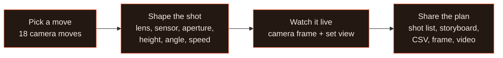

## Features

| | |
|---|---|
| **18 camera moves** | Push in, pull out, orbit, dolly zoom, crane, tracking follow and more, on a timeline. Each move explains why filmmakers use it. |
| **Real lens behaviour** | Focal length 14 to 135 mm, aperture f/1.4 to f/11 driving depth of field, plus bloom, motion blur and film grain. |
| **Camera sensors** | Super 35, Full frame, APS-C, Micro Four Thirds, 1-inch. Lenses show their full-frame equivalent. |
| **Cinematic looks** | Golden hour, Teal and orange, Night, Noir, Neutral, plus time-of-day looks (dawn, noon, dusk), with window light and sun shafts. |
| **Ten sets** | Chai stall, village street (houses, lamp post, auto-rickshaw, scooter, bicycle), a rooftop terrace (water tank, clothesline, rope cot, brass pots, bucket), a tiled living room (barred window with curtains, sofa, TV, tea table with steel tumblers, wall clock, standing lamp) and a school classroom (blackboard, bench-desks, teacher's table with a globe, ceiling fan, barred windows) and a railway platform (coach on the line, pillars and canopy, a station board in English, Tamil and Hindi, benches, luggage), a temple courtyard (stepped gateway tower, pillars with marigold garlands, brass lamp tower, flag pole, bell) and an office (desks with monitors, whiteboard, window, filing cabinet), a bus interior (cutaway with bench seats, hand rails, a driver's end) and a market (stalls with awnings and produce, a hand cart, a vendor's umbrella, a balance scale). The set is saved in the project. |
| **Costumes** | Dress each actor with a topi and glasses, turban, student bag, marigold garland, dupatta or umbrella, or a whole outfit: kurta and pyjama, shirt and dhoti, shirt and lungi, saree and blouse, school uniform, formal wear. |
| **Walk paths** | Click up to six points on the set view and the actor walks through them, facing the way they move. The route shows in the set view and the blocking diagram. |
| **Tamil, Hindi and English** | Switch the whole interface between English, தமிழ் and हिन्दी with the language menu. Titles, shot names and notes in any script also come out correctly in the PDFs. |
| **Choose your actors** | Seven Microsoft Rocketbox avatars (three women, four men, including an older man) play the two roles. Pick them in the cast dialog; names, eye heights and animations follow your choice, and the cast is saved in the project. |
| **Actions for each actor** | Choose what Meera and Arjun do in every shot: stand, walk, sit on a plastic chair, talk, listen, nod, sip chai, wave, look around, shrug, invite the other to sit, eat a snack, talk on the phone or offer something. See the [contact sheet](docs/samples/actions-contact-sheet.pdf). |
| **Reference video analysis** | Import a clip: Kalki finds its shots, names the camera move in each (pan, tilt, truck, push, pull, zoom, handheld or locked off), shows the pacing, suggests changes to your scene with the reason for each, and plays the result as a simulation. It runs on your computer and the video is never uploaded. |
| **Action lane** | Sequence actions inside one shot: Meera sits, then talks at 2.5 s, then sips chai at 5.5 s, while Arjun listens and nods. Parts blend smoothly and you retime them with a slider. |
| **Place the actors** | Click or drag on the set view to put Meera and Arjun anywhere on the floor, and set which way they face. The camera follows them. |
| **Any frame** | Cinema 2.39:1, YouTube 16:9, Reels and Shorts 9:16, square. |
| **Frame guides** | Press **G** to cycle rule of thirds, action and title safe areas with a centre mark, and (on 9:16) approximate Reels and Shorts interface zones. |
| **Shot notes** | A notes field on every shot for intent, blocking and references. |
| **No-code and Code modes** | Edit visually, or edit the whole scene as structured JSON. |
| **Safe by design** | Versioned `.kalki.json` projects that keep opening, undo and redo, and automatic Light mode on slow CPUs. |

### Cinematic looks

The same shot under four looks:

| Golden hour | Teal and orange |
|:-:|:-:|
| 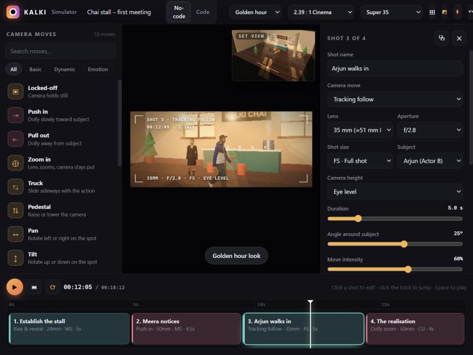 | 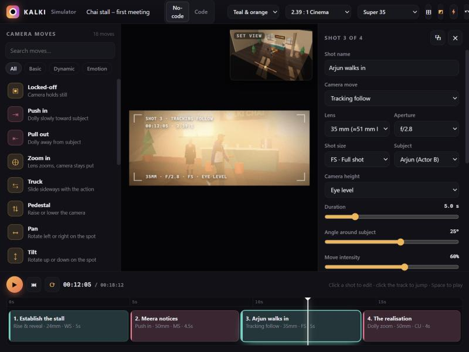 |
| **Night** | **Noir** |
| 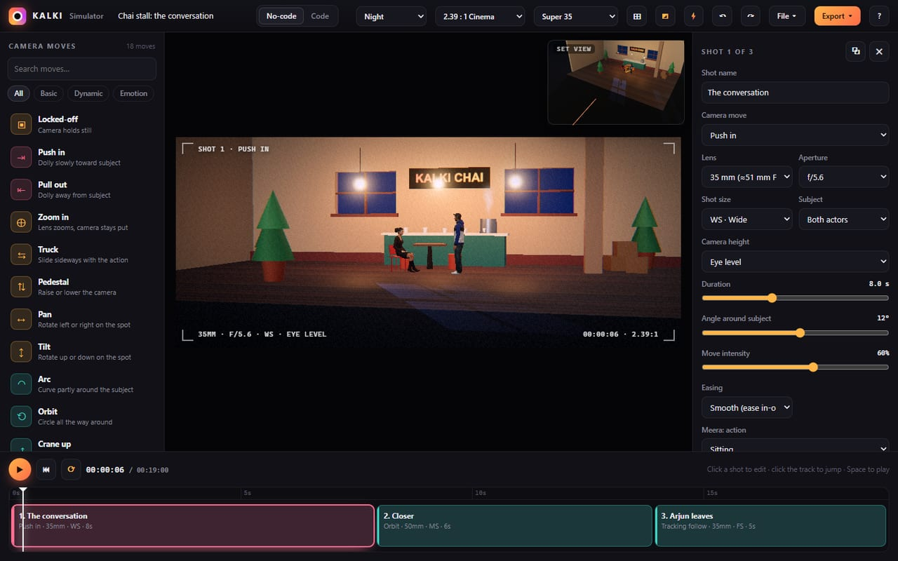 | 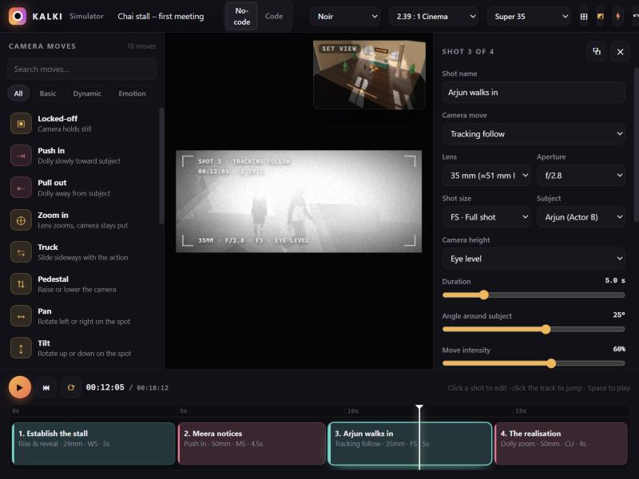 |

### Tamil, Hindi and English

The language menu in the top bar switches every label, tooltip, message and explanation between English, தமிழ் and हिन्दी, and remembers your choice. The translations were written without a native-speaker review, so corrections are welcome.

| தமிழ் | हिन्दी |
|:-:|:-:|
| 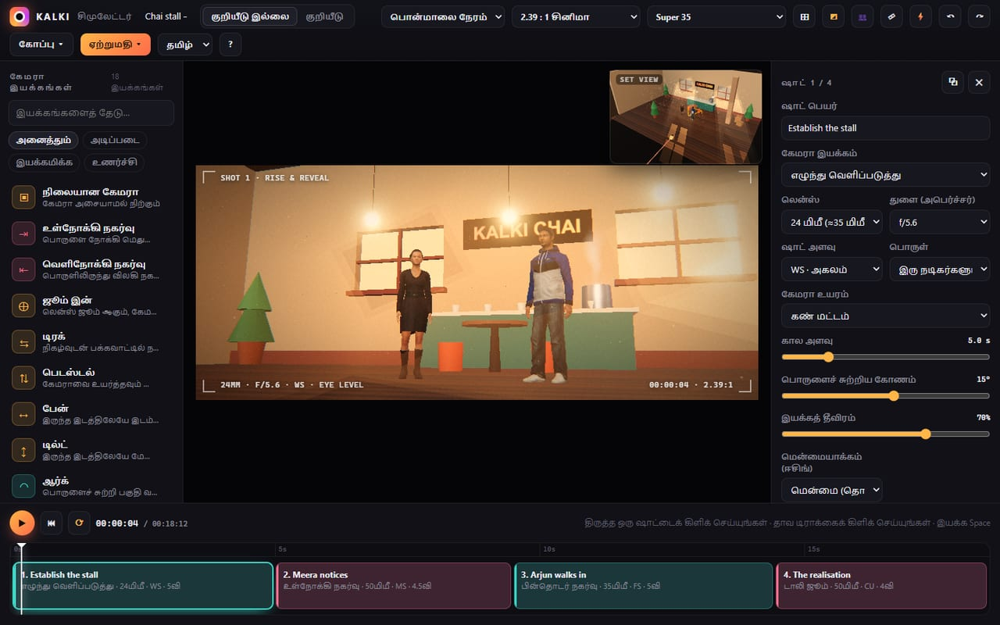 | 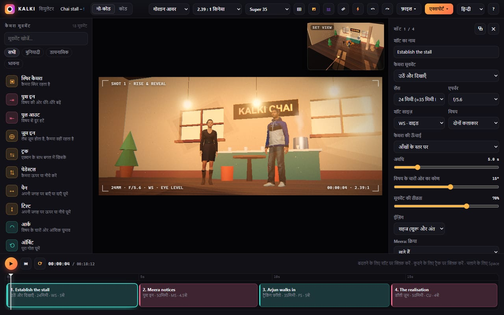 |

### Time of day

Dawn, noon and dusk join the other lighting looks.

| Dawn | Noon | Dusk |
|:-:|:-:|:-:|
| 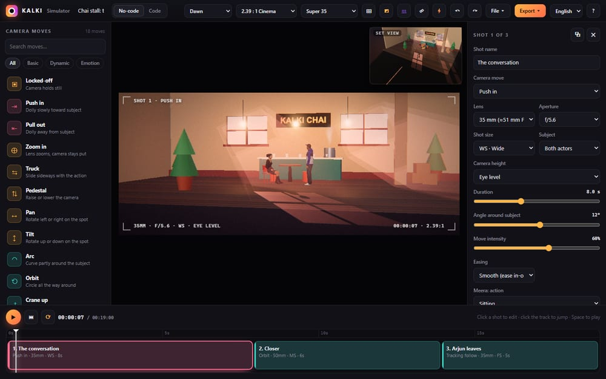 |  |  |

### Sets, costumes and walk paths

Pick a set from the menu in the top bar, dress each actor in the cast dialog, and draw a walk path with the Walk path buttons in the inspector.

<p align="center">
  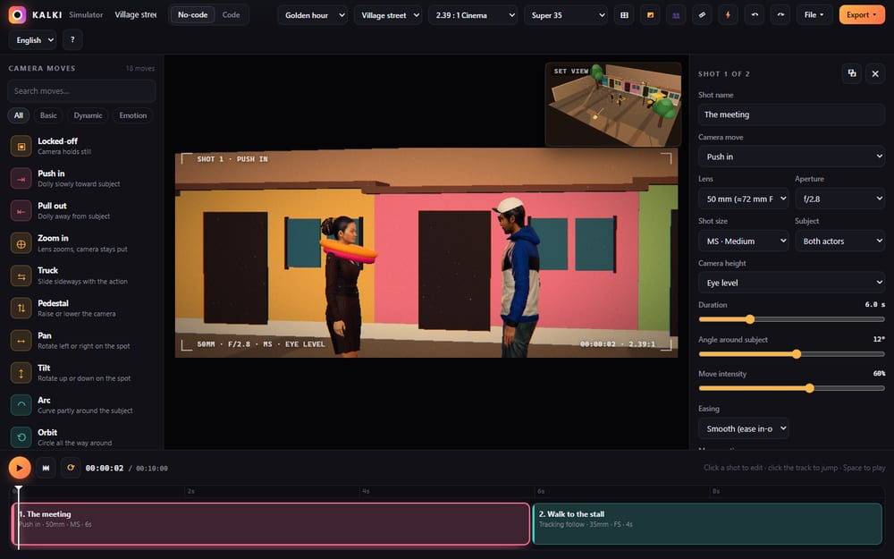
</p>

| Village street | Terrace |
|:-:|:-:|
| 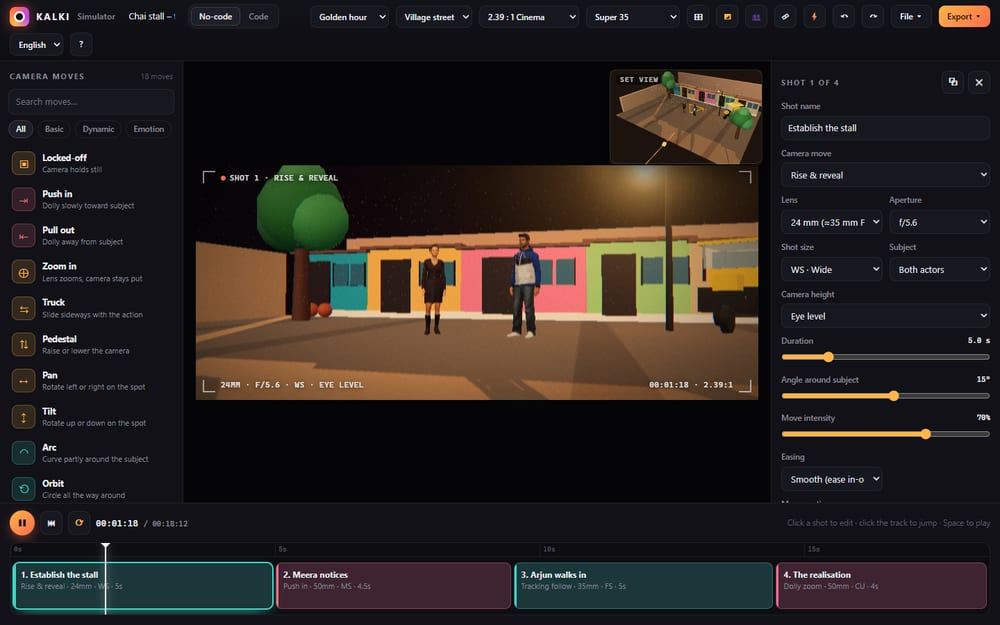 | 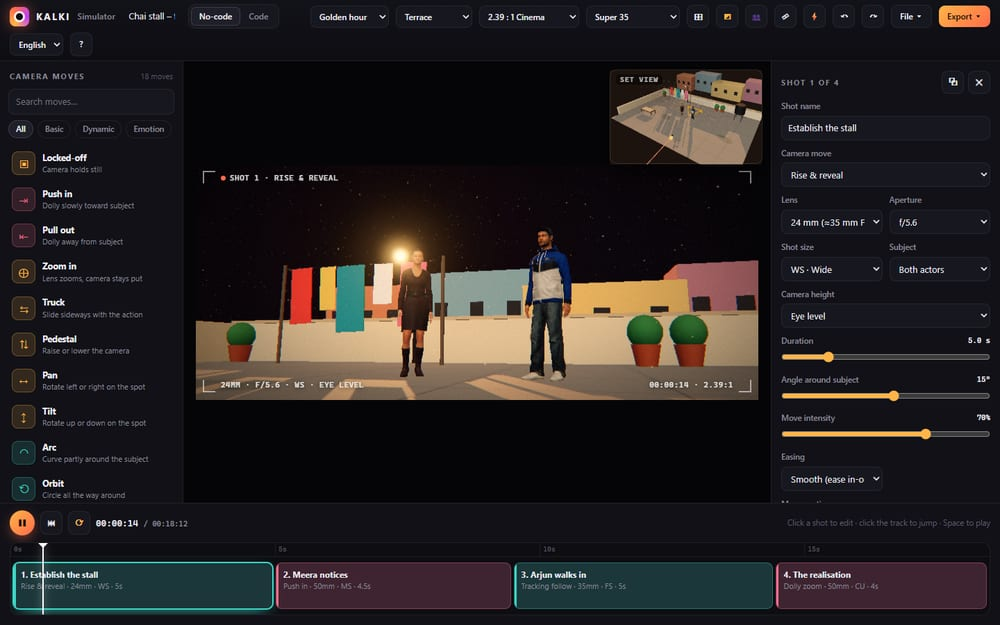 |

<p align="center">
  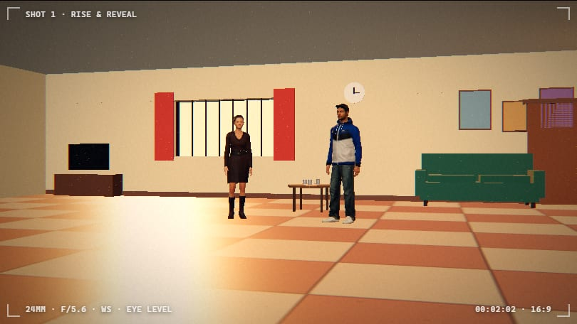 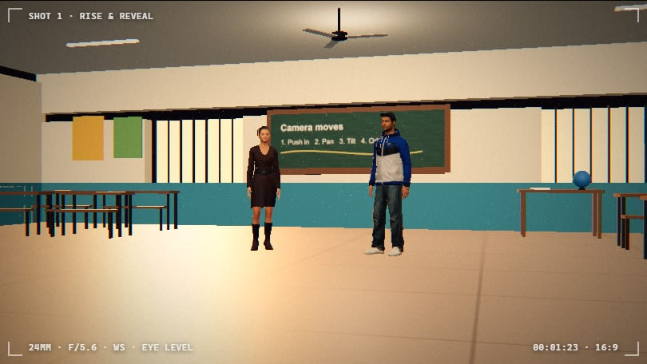<br>
  <sub>Living room and classroom</sub>
</p>

<p align="center">
  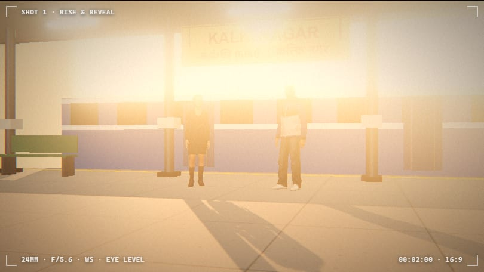<br>
  <sub>Railway platform</sub>
</p>

<p align="center">
  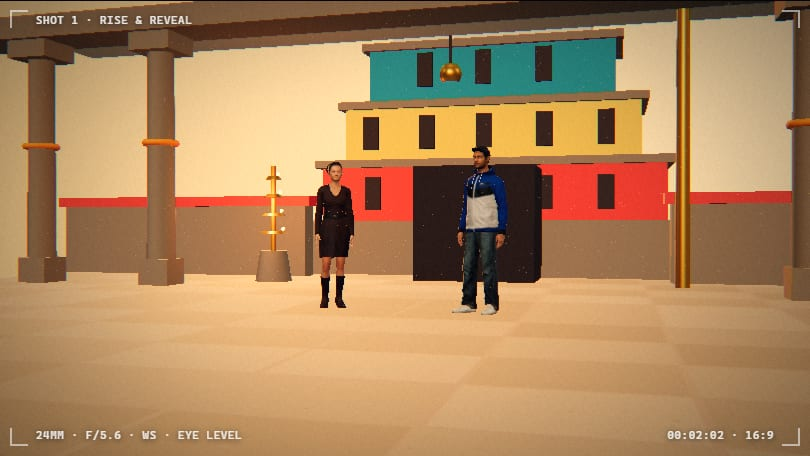 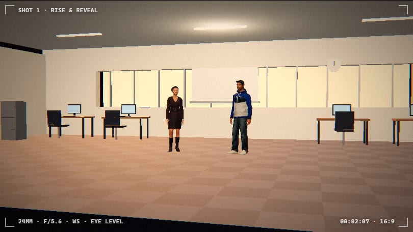<br>
  <sub>Temple courtyard and office</sub>
</p>

<p align="center">
  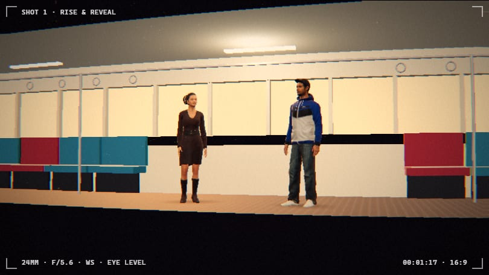 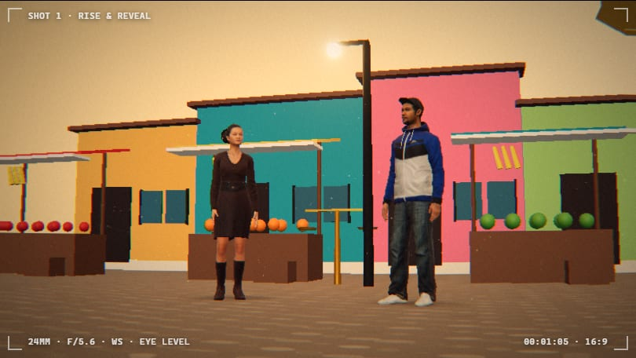<br>
  <sub>Bus interior and market</sub>
</p>

### Whole-garment costumes

Besides the small accessories (topi, turban, garland, dupatta, umbrella, school bag), the cast dialog now has six whole outfits: **kurta and pyjama**, **shirt and dhoti**, **shirt and lungi** (a blue check), **saree and blouse** (with a pallu over the shoulder), **school uniform** (with bag) and **formal shirt and trousers**. A garment is a second skin laid over the avatar's own clothes, in plain or simply patterned cloth, so it bends with every action and works on all seven avatars. It is an approximation: no folds, drape or fine detail, a few details of the original clothes (a belt, a cuff) can still show, and the saree is a skirt, blouse and shoulder cloth rather than a real wrap.

### Choose your actors

Press the people button to open the cast dialog and pick who plays each role. Every avatar uses the same fifteen actions, placement and camera work. Eating a snack, being on the phone and offering something reuse the sipping and inviting animations with a different prop, so they look like those motions rather than new ones.

<p align="center">
  
</p>

### Lessons, templates and camera rigs

The graduation-cap button opens ready-made lesson scenes (a tour of all 18 moves, shot sizes, lenses, depth of field, push in vs zoom, dialogue coverage and camera rigs) and shot templates (dialogue pair, walk and talk, tension build, scene opener, Reels hook) that are added to the end of your scene. Each shot can also show the camera rig that would make the move in real life: tripod, dolly and track, slider, circular track, jib, gimbal or handheld, drawn in the set view with a low-budget tip. On a phone-sized screen the view sits on top, with tabs for the moves and the shot settings.

### Realism

v0.11.0 is a first realism pass. What changed, and what did not:

- **Actors with signs of life.** On top of the recorded animation, each actor now breathes, shifts weight while standing, blinks every few seconds (sometimes twice), and looks at the other actor: the eyes follow fully, the head and neck partly, with the small quick eye movements people make. Eyelids use the avatar's own eyelid bones.
- **Real lens behaviour.** Wide lenses bend straight lines at the edges (barrel distortion), long lenses very slightly the other way; a lens opened wide vignettes and fringes more than one stopped down. Handheld shake is now a three-layer motion (slow drift, body sway, fine tremor) instead of a mix of sine waves. Bloom only comes from real highlights, so bright walls no longer fog the picture.
- **Less toy-like sets.** Skies behind the outdoor sets (blue at noon, orange at dusk, dark at night), floors that continue instead of ending in black, plaster with soft mottling and grime, lumpy foliage, a soft contact shadow under each actor, and a warm sheen on skin and cloth.
- **Smooth turns (v0.12.1).** At a corner of a walk path the body now turns over about half a metre before and after it instead of snapping to the new direction, and a walking actor looks ahead along the path instead of at the other actor. Turning on the spot to face someone new happens at a cut, so it is not animated; a stepping-turn animation would need new recorded animation data.
- **Facial expressions (v0.12.0).** Each shot has an Expression menu for each actor: Automatic, Neutral, Smiling, Serious, Sad, Surprised or Angry. Automatic lets the action decide (a wave or an invitation smiles, thinking frowns slightly, a shrug raises the brows), the strength drifts a little so a held face is never frozen, expressions fade smoothly from one to the next, and the brows lift for emphasis while talking. The expressions move the avatars' own brow, cheek, lid and lip bones; they are subtle, not exaggerated, and the surprised face keeps the mouth closed because opening it slightly exposed the mouth interior as a dark slab. The choice is saved in the project (file format version 11).
- **Talking mouths (v0.11.2).** While an actor is talking (or on the phone) the jaw opens and closes with the rhythm of speech, 3 to 7 syllables a second in phrases of 1 to 4 seconds with pauses, and the lips spread and round with the vowel; a listening actor keeps the mouth still. It is the natural rhythm of speech, not lip-sync to words.
- **Walking without sliding feet (v0.11.1).** The walk cycle is now played by distance travelled instead of by time, using each avatar's measured natural walking speed, so the planted foot stays on the floor: measured sliding of the planted foot fell from about 0.74 to 0.07 m/s at a slow walk and from 0.46 to 0.23 m/s at a fast one.
- **Not done, and honest limits.** The sets are still built from simple shapes with flat colours, with no photographic textures, so they remain stylised. The recorded animations are limited to the ten original clips plus three that reuse them with props. There is no stepping-turn animation, there are no wrinkles, tears or fine skin movement, only the simple expressions above, and no cloth or hair movement. Detail bump-mapping was tried and removed because it made frames shimmer and confused the camera-motion analysis.

### Teaching and writing tools

- **Assignments** (clipboard button): a teacher writes a short brief and adds checks Kalki can verify (number of shots, runtime, a move or shot size used, a note on every shot, no repeated moves, frame). The assignment is saved in the project file, so a student who opens it sees the brief and a live checklist, and can save a plain-text report to hand in.
- **Compare with another project** (File menu): a shot-by-shot table of a student's scene against another version, with the differences highlighted. It compares by position and does not play the two side by side.
- **Import script** (File menu): reads Fountain or plain screenplay text and builds a shot-list skeleton: each scene heading becomes an establishing wide, each action a medium shot (walking actions are followed), and each line of dialogue a shot on the speaker, shown over the shoulder. The location is picked from the scene headings, and speakers named like an avatar (for example Meera or Ravi) take that role. It is a starting point to refine, not a coverage plan.

### Learn from a reference video

Press the film-strip button, choose a clip, and Kalki reports how its camera work is built. It finds each shot, names the move, shows how long each lasts and how confident it is, explains the technique, and compares the clip with your scene. Each suggestion names its rule and its reason, and you can apply one or all, then play the result. Ctrl+Z restores your scene.

<p align="center">
  
</p>

How it works: cuts are found where no camera motion can explain the change between two frames; camera motion is estimated per shot by following small blocks of the picture and fitting a shift, zoom and roll; depth cues separate a pan from a truck. There is no machine-learning model, so shot size and subject framing are not analysed yet. To try it, import the 8-second test clip [`street-scene-test-clip.webm`](docs/samples/street-scene-test-clip.webm): a pan, a cut, a zoom in, a cut and a locked-off hold. Results are estimates (a push-in and a zoom can look alike), and the report says so.

### Sequence actions inside a shot

Give each actor a sequence in the action lane: here Meera sits, then talks at 2.5 s, then sips chai at 5.5 s, while Arjun listens and nods. Parts blend smoothly, and you retime or remove them from the inspector.

<p align="center">
  
</p>

### Code mode

Everything in a scene is plain data, so setups are precise and repeatable.

<p align="center">
  
</p>

## Exports

| Export | What you get | Sample |
|---|---|---|
| **Shot list (PDF)** | A landscape A4 sheet: a frame for every shot, with move and intent, timing, lens and full-frame equivalent, aperture, shot size, height, angle, subject and your notes | [`shot-list-sample.pdf`](docs/samples/shot-list-sample.pdf) |
| **Storyboard sheet (PDF)** | A grid of frames with number, name, move, lens, size, duration and your note. The grid adapts to the aspect ratio | [`storyboard-sample.pdf`](docs/samples/storyboard-sample.pdf) |
| **Blocking diagram (PDF)** | A top-down map for every shot: where each actor stands and moves, where the camera starts, its view cone and its path | [`blocking-diagram-sample.pdf`](docs/samples/blocking-diagram-sample.pdf) |
| **Spreadsheet (CSV)** | The same data for Excel or Sheets | |
| **Frame (PNG)** | The current frame without overlays | [`frame-export-sample.png`](docs/images/frame-export-sample.png) |
| **Preview video (WebM)** | The whole sequence, recorded in one pass | |
| **Project (`.kalki.json`)** | Save and reopen your scene | |
| **AI reference (PNG + TXT)** | The current frame plus a text file with a prompt and the camera plan for every shot, to paste into AI video tools. The words are generic and AI tools read them loosely | |

**Document details** (Export menu) put your production, director, scene, shoot day, an accent colour and a small logo at the top of the PDFs, in English, Tamil or Hindi headings. They are saved in the project. Under the lens menu you can also pick phone sensors and an anamorphic squeeze (1.33x, 1.5x, 2x); the anamorphic option uses the full sensor height, so the picture is taller than a spherical lens of the same focal length. Oval bokeh and flares are not simulated.

<p align="center">
  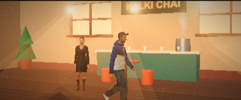<br>
  <sub>A frame exported with Export → Frame snapshot</sub>
</p>

## Version history

| Version | Highlights |
|---------|------------|
| v0.1 | First prototype: 18 camera moves, timeline, no-code and code modes, onboarding, exports |
| v0.2 | Cinematic look: window light and sun shafts, depth of field, bloom, motion blur, grain, 5 looks |
| v0.3 | Realistic animated actors (some browsers failed to load textures) |
| v0.3.1 | Actor textures fixed for all browsers, brighter wide shots |
| v0.4 | Shot-list PDF, sensor presets with full-frame equivalents, versioned project files |
| v0.4.1 | Storyboard sheet PDF, per-shot notes, Windows desktop app |
| v0.4.2 | Frame guides (thirds, safe areas, Reels zones), built-in self-test, PDF text fix |
| v0.5 | Actions for each actor (sit, talk, listen, nod, sip chai, wave, look, shrug, invite), chair and glass props |
| v0.5.1 | Click-to-place actors, facing control, top-down blocking diagram PDF |
| v0.5.2 | Action lane: timed action changes inside a shot, with blending |
| v0.5.3 | Reference video analysis with suggestions and simulation; Pan direction fix |
| v0.5.4 | Actor picker with seven avatars |
| v0.6.0 | Tamil and Hindi interface, Tamil/Hindi text in PDFs, dawn / noon / dusk looks |
| v0.6.1 | Village street and terrace sets, costumes, multi-point walk paths |
| v0.7.0 | Lesson scenes and shot templates, camera rigs in the set view, phone layout |
| v0.7.1 | Video-analysis report as PDF, camera rig in the shot-list PDF |
| v0.7.2 | Mark shot sizes in the video analysis (used by suggestions, simulation and reports) |
| v0.7.3 | Living room set and more props (scooter, bicycle, sofa, brass pots, tea table) |
| v0.7.4 | Classroom set, daylight through the windows of the indoor sets |
| v0.7.5 | Indoor window daylight follows the look (dark at night) |
| v0.7.6 | Railway platform set |
| v0.7.7 | Pacing chart in the video analysis and its PDF report |
| v0.7.8 | Tamil and Hindi for lesson, template and camera rig text |
| v0.8.0 | AI reference export, PDF document details (logo, colour, language), phone sensors and anamorphic squeeze, performance guard |
| v0.9.0 | Assignments for teachers, project comparison, script import |
| v0.9.1 | Three new actions: eating a snack, on the phone, offering something |
| v0.10.0 | Whole-garment costumes: kurta, dhoti, lungi, saree, school uniform, formal wear |
| v0.10.1 | Temple courtyard and office sets |
| v0.11.0 | Realism pass, bus interior and market sets |
| v0.11.1 | Walking without sliding feet |
| v0.11.2 | Talking mouths |
| v0.12.0 | Facial expressions per actor and shot |
| **v0.12.1** | **Latest.** Smooth turns at path corners |

Every build is kept in [`Kalki-versions/`](Kalki-versions/). See [`VERSIONS.txt`](Kalki-versions/VERSIONS.txt).

## Roadmap

Kalki is built in small, shippable steps. Full detail, effort estimates and rationale are in [`docs/ROADMAP.md`](docs/ROADMAP.md).

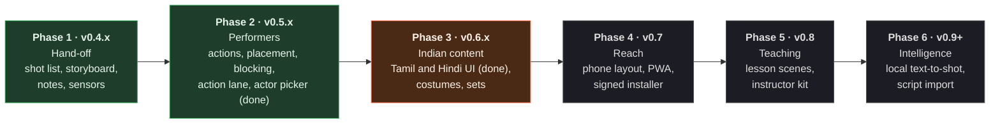

<sub>Green: shipped. Orange: next. Grey: planned. The Windows installer from Phase 4 has a first version already; code signing and offline WebView2 bundling are still open.</sub>

## Market and benchmark

- [`docs/MARKET_ANALYSIS.md`](docs/MARKET_ANALYSIS.md): target users in India, trends, pain points, pricing and positioning.
- [`docs/BENCHMARK.md`](docs/BENCHMARK.md): feature comparison with other previs, shot-list and storyboard tools.

In short: professional previs tools are priced in USD and out of reach for most Indian creators and students, and the realistic alternative is no previs at all. Kalki aims to be offline, Indic-language and quick to learn.

## Building from source

Requires Node.js. The desktop app additionally needs the [Rust toolchain](https://rustup.rs) and the Microsoft C++ Build Tools.

```bash
npm install
node build.mjs            # -> dist/Kalki.html (obfuscated)
DEBUG=1 node build.mjs    # unobfuscated build for debugging
npm test                  # PDF and analysis tests, in-browser self-test, real-video end-to-end test (needs Edge or Chrome)
npm run desktop:dev       # run the desktop app in development
npm run desktop:build     # build the Windows installer (src-tauri/target/release/bundle/nsis)
```


`optimize.mjs` and `texfix.mjs` rebuild the actor assets; they need the original FBX/TGA files, which are not included. Design notes are in [`DEVELOPMENT.md`](DEVELOPMENT.md).

## Feedback

Kalki Simulator is a closed-source project and does not accept code contributions. Feedback from filmmakers, film teachers and translators is very welcome: tell the author what would make it more useful on your shoots.

## Privacy

Kalki never connects to the internet and collects no data. Files are saved only where you choose to save them.

## Credits and licences

- [three.js](https://threejs.org), MIT
- [Microsoft Rocketbox](https://github.com/microsoft/Microsoft-Rocketbox) avatars and animations (Female_Adult_11, Male_Adult_17), MIT

Full notices: [`THIRD-PARTY-NOTICES.txt`](THIRD-PARTY-NOTICES.txt). Kalki Simulator itself is proprietary software: see [`LICENSE`](LICENSE). The third-party components above keep their own licences.
